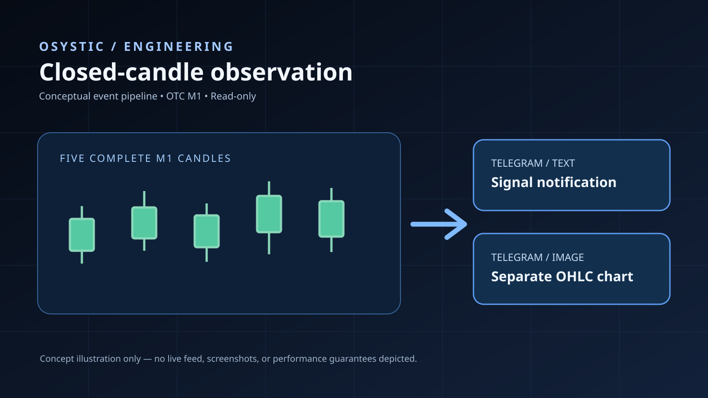

# Quotex OTC Five-Candle Telegram Alert Automation

> **OSYSTIC ENGINEERING CASE STUDY · PUBLIC SHOWCASE · COMPLETED 31 OCTOBER 2026**
>
> Independent, sanitized portfolio record. **No client identity, proprietary source code, broker credentials, Telegram tokens, private logs, screenshots, contracts, or trading accounts.**

## At a glance

| Item | Verified scope |
|---|---|
| Engagement | Completed client delivery, 31 October 2026 |
| Domain | Read-only OTC market monitoring and alert automation |
| Platforms | Chrome extension (Manifest V3), Windows PC local relay, Telegram |
| Signal rule | Five consecutive **completed** 1-minute candles, all GREEN or all RED |
| Output | Telegram text alert first; separate five-candle data-derived chart image |
| Markets | Dynamic available-OTC catalogue; measured 61/61 in one completed probe, later 60/60 active in a successful screenshot |
| Windows lifecycle | Local relay, startup helper, user-controlled connection and monitoring |
| Delivery format | Two separate Telegram messages per eligible signal |
| Live acceptance | Working text alerts and chart images demonstrated; client confirmed completion |
| Status | **Client engagement completed**; long-term broker reconnection limitations documented |

## Executive summary

OSYSTIC delivered a read-only browser-observation and Windows-local Telegram alert workflow for OTC instruments. A signal is eligible only after five consecutive, fully closed one-minute candles agree in direction. The system sends a text alert first and a separately rendered OHLC chart afterwards. This case study documents verified test windows and known feed-recovery constraints, rather than claims of trading profitability or uninterrupted availability.

## Ownership and handover

The completed delivery was handed over for operation on the client's Windows environment, with the Chrome observer, local relay, startup helper, installation guidance and agreed maintenance support. Browser login/session availability and Telegram configuration remain under client control. This public repository is a sanitized documentation-only showcase, not a deployment package or source-code handover.

## Visual architecture



*Editorial architecture illustration. Not a broker screenshot, market-data capture, or independent proof of trading performance.*

## The challenge

Continuously observe a changing catalogue of broker OTC instruments on an ordinary Windows PC. For each symbol, detect an event only after **five genuine, consecutively closed one-minute candles** share the same direction. Deliver the result to Telegram quickly without combining the chart upload with the initial notification.

The design also needed to avoid trades, preserve client credentials, correctly handle candle boundaries and interruptions, and expose observable coverage/reconnection health rather than claiming stale historical tests prove live market health.

## OSYSTIC PACE

### P — Problem and constraints

An external broker feed can reconnect, change its available instruments, lose subscriptions, or stop sending some symbols while keeping a WebSocket open. A PC can sleep or lose connectivity. Telegram text and photo endpoints can have different latencies or transient failures.

### A — Architecture and decisions

```text
Browser-based broker OTC data (read-only)
     |
     v
Live OTC catalogue + subscription/coverage health
     |
     v
Per-symbol UTC M1 candle aggregation
     |
     v
5 closed, contiguous, same-colour candles
     |
     +----> Fast Telegram text notification
     |
     +----> Frozen 5-candle OHLC snapshot
                |
                v
         Data-derived PNG chart
                |
                v
         Separate Telegram photo
```

The Chrome observer monitors the active broker session; a Windows-local relay handles Telegram delivery. Text and photo have independent delivery paths and bounded retry behavior. Feed coverage reports distinguish actively updating markets from markets seen earlier.

### C — Contribution and delivery

OSYSTIC implemented market discovery, candle-close validation, signal deduplication, read-only alert delivery, chart rendering, Windows relay/startup utilities, recovery diagnostics, and automated test fixtures. The client received the software, installation assistance, live troubleshooting, and agreed follow-up bug-fix support.

### E — Evidence and outcomes

- A 90-second live test captured qualifying price activity on **61 of 61 available OTC markets** at that moment; a later successful screenshot displayed **60 of 60 active** while monitoring.
- Live Telegram screenshots confirm automatically generated **text alerts followed by separate data-derived five-candle charts**.
- Correct market, candle colour and fifth-close UTC timestamp are included in the alerts.
- A recorded signal sample delivered initial text alerts in about **2–3 seconds**; the customer approved a **10–20-second** tolerance for text alerts, with photos arriving separately.
- Client confirmed project completion and released both agreed delivery milestones.

**Important:** The evidence represents bounded field tests, not an uninterrupted 24/7 uptime benchmark. A prior broker-socket interruption left most feeds inactive until manual refresh; the broker controls reconnection/session behavior. Not every photo was within the preferred delay during traffic bursts. These limits are intentionally not hidden.

## Technology

`JavaScript` · `Chrome Manifest V3` · `WebSocket market data` · `M1 OHLC` · `Windows PowerShell` · `Windows local HTTP relay` · `Telegram Bot API` · `PNG chart generation` · `Node.js testing`

## Public vs. private boundary

| Public case study (this repo) | Confidential engineering archive |
|---|---|
| Sanitized architecture and PACE story | Implementation source and QA scripts |
| Capability and bounded test evidence | Detailed technical test fixtures |
| No client identity or commercial details | Private completion/support record |
| No broker or Telegram credentials | Windows token remains on client device |
| Portfolio-ready engineering proof | Not for public distribution |

The public showcase has **independent Git history** and is not a fork, mirror, or code export of the confidential implementation.

## Not claimed

This project does **not** guarantee investment returns, profitable signals, broker affiliation/endorsement, permanent Quotex session access, exactly-once Telegram delivery under ambiguous network failures, guaranteed 24/7 all-market availability, or unsupervised Windows recovery after any broker-side outage.

## Additional documentation

See [Case Study](case-study.md), [Architecture](docs/architecture.md), [Verification](docs/verification.md), and [Closeout](docs/completion.md).

**Published by OSYSTIC.** Engineering project completed; public documentation remains maintained for accuracy.
